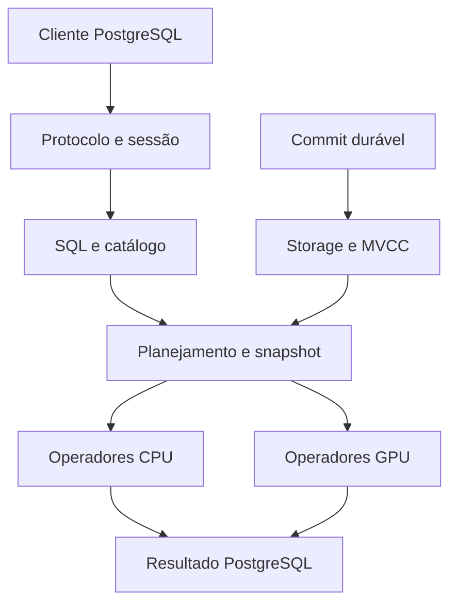

# Especificação — banco SQL em Rust com GPU e protocolo PostgreSQL

Versão: 0.1 • Data: 12/10/2026 • Status: proposta de engenharia, sem resultados medidos.

## 1. Objetivo e limites

Construir um banco independente, com servidor em Rust, SQL, persistência local, transações e aceleração opcional por NVIDIA/CUDA e AMD/ROCm/HIP. Clientes deverão conectar pelo protocolo PostgreSQL. A primeira vantagem buscada será em filtros e agregações sobre grandes volumes; operações pequenas e transacionais permanecerão em CPU.

Não existe promessa de superar PostgreSQL em todas as cargas. Rust e GPU, isoladamente, não garantem ganho. O projeto deverá provar correção, durabilidade e desempenho por carga antes de qualquer afirmação comercial.

Construir do zero significa criar e integrar o produto e seus contratos. A recomendação é reutilizar componentes maduros para SQL, execução CPU e armazenamento. Reescrever também parser, otimizador e storage é uma trilha de pesquisa separada e ampliará significativamente o trabalho.

### Entregas

1. Servidor executável sem GPU.
2. SQL documentado e persistência recuperável.
3. Conexão por psql, Ruby pg e drivers PostgreSQL.
4. Compatibilidade Rails validada para versões fixadas.
5. Execução GPU opcional com fallback CPU.
6. Harness de benchmarks, dados reproduzíveis e relatório de resultados.

## 2. Decisões de arquitetura

| Área | Decisão inicial | Justificativa |
|---|---|---|
| Servidor | Rust, Tokio, tarefas bloqueantes fora do reactor | Separar rede, disco e computação |
| SQL/CPU | Apache DataFusion e Arrow | Reutilizar planejamento e execução colunar extensível |
| Transações | Camada própria com MVCC sobre storage transacional | DataFusion não fornece um banco OLTP completo |
| Storage inicial | RocksDB TransactionDB via integração Rust/FFI | Reutilizar WAL, recuperação e persistência de chaves |
| Leituras analíticas | Converter snapshot visível para lotes Arrow | Começar sem duplicação persistente de dados |
| Storage colunar | Segmentos imutáveis Parquet na fase posterior | Reduzir custo de scans; exige integrar delta e versões |
| GPU | Interface comum; CUDA primeiro, HIP depois | Dois backends reais, com testes separados |
| Protocolo | PostgreSQL v3.0 inicialmente | Compatibilidade com clientes tradicionais |
| Observabilidade | tracing, métricas, EXPLAIN ANALYZE | Tornar custo e gargalos verificáveis |

DataFusion será o motor de consultas, não um substituto da implementação de catálogo, DML, constraints, transações e recuperação. Sua compatibilidade SQL deverá ser adaptada e testada; não presumir semântica PostgreSQL completa.

Não criar WAL próprio além do WAL do RocksDB nesta primeira arquitetura. Um motor de storage inteiramente próprio pode substituir esse componente futuramente, mediante novo contrato de recuperação.

## 3. Fluxo de execução



O planejador determina os operadores elegíveis para GPU. O resultado mantém os mesmos tipos e regras, independentemente do dispositivo.

## 4. Estrutura do repositório

```text
crates/
  server/           # configuração, ciclo de vida e TCP
  pgwire/           # mensagens, autenticação, codecs e sessão
  catalog/          # schemas, tabelas, tipos e constraints
  sql/              # normalização e regras PostgreSQL suportadas
  planner/          # estatísticas, custos e seleção de dispositivo
  executor/         # integração DataFusion e operadores CPU
  storage/          # integração RocksDB, índices e snapshots
  transactions/     # MVCC, conflitos e commits
  gpu-api/          # contratos de buffers e operadores
  gpu-cuda/         # integração CUDA
  gpu-hip/          # integração HIP/ROCm
  metrics/          # métricas e tracing
  bench/            # geração, execução e relatórios
kernels/cuda/
kernels/hip/
tests/{sql,protocol,transactions,recovery,drivers}/
benchmarks/{queries,profiles,results}/
docs/{architecture,compatibility,operations}/
```

Fixar toolchain, Cargo.lock, versões Arrow/DataFusion compatíveis e imagens por versão/digest. Features de compilação propostas: cpu, cuda e hip; a build cpu não deverá exigir SDK GPU. Kernels CUDA/HIP podem ser escritos em C++ e chamados por ABI C: o núcleo do produto permanece Rust. Isolar e documentar todo unsafe.

## 5. SQL e tipos

### MVP analítico

CREATE TABLE, DROP TABLE, INSERT em lote, SELECT, WHERE, projeção, LIMIT, ORDER BY, COUNT, SUM, MIN, MAX, AVG e GROUP BY. Equijoin simples na CPU. COPY FROM STDIN em texto para carga. Tudo que não estiver implementado deve retornar erro explícito.

### MVP transacional

UPDATE, DELETE, BEGIN, COMMIT, ROLLBACK, parâmetros $1, prepared statements, PRIMARY KEY, UNIQUE, NOT NULL, CHECK limitado, INSERT RETURNING e UPDATE RETURNING. ALTER TABLE terá operações enumeradas, sem aceitar silenciosamente sintaxe incompleta.

| Tipo SQL | Representação | Contrato |
|---|---|---|
| boolean | bool + validade | Lógica SQL de três valores |
| smallint/integer/bigint | i16/i32/i64 | Overflow detectado |
| numeric(p,s) | decimal exato | Inicialmente p <= 18; operações intermediárias verificadas em CPU |
| real/double precision | f32/f64 | Tolerância apenas nos testes destes tipos |
| text/varchar | UTF-8 + offsets | Collation inicial explicitamente limitada |
| bytea | bytes | Codec PostgreSQL correspondente |
| date | dias relativos ao epoch interno | Conversão correta para protocolo PG |
| timestamp/timestamptz | micros + regras documentadas | TZ da sessão, precisão e codecs testados |
| uuid | 16 bytes | Texto e binário compatíveis |

Não usar float para dinheiro. Numeric sem precisão explícita, arrays, JSONB, extensões, PL/pgSQL, triggers e funções PostgreSQL arbitrárias ficam fora do primeiro escopo. Operações GPU de decimal só serão habilitadas após comprovar overflow e precisão equivalentes.

Definir comportamento para NULL, NaN, divisão por zero, casts, ordenação com NULLS FIRST/LAST, strings e datas. Implementar ORDER BY antes de LIMIT quando solicitado. Sem ORDER BY, a ordem não é garantida.

## 6. Compatibilidade PostgreSQL e Rails

Usar o mesmo adaptador exige quatro camadas: transporte, protocolo, tipos e comportamento SQL/catálogos. Aceitar uma conexão não significa conseguir executar migrations ou uma aplicação Rails existente.

### Contrato de protocolo

- StartupMessage, SSLRequest, autenticação SCRAM-SHA-256 e TLS para uso remoto.
- ParameterStatus, BackendKeyData e ReadyForQuery com estado correto.
- Simple Query; fluxo extended Parse/Bind/Describe/Execute/Sync/Close/Flush.
- Prepared statements nomeados e sem nome, portais e limites de linhas.
- RowDescription, DataRow, CommandComplete, ErrorResponse e SQLSTATE.
- Tipos/OIDs suportados e formatos texto/binário sem anunciar suporte inexistente.
- CancelRequest, desconexão, timeout e recuperação após erro de protocolo.
- COPY FROM STDIN; COPY OUT e binário podem ficar para fase posterior.
- Após erro em transação: estado abortado até rollback, conforme contrato suportado.

Não falsificar uma versão completa de PostgreSQL para esconder limitações. Publicar a versão do produto e uma matriz de compatibilidade.

### Gates de integração

1. psql: conexão, consulta, erro, cancelamento e COPY.
2. Ruby pg/libpq: parâmetros, NULL, codecs, resultados e transações.
3. tokio-postgres e psycopg: consultas preparadas e pool.
4. Rails/ActiveRecord, em versões fixadas: estabelecer conexão, descobrir schema, inserir, atualizar, excluir, RETURNING, timestamps, transações e pool.
5. Migrations selecionadas: identity/sequence, índices, defaults e alterações de schema suportadas.

Capturar as consultas efetivamente emitidas pelo Rails em testes. Implementar o subconjunto necessário de pg_catalog e information_schema, SET/SHOW, search_path, timezone, current_schema, version, savepoints, sequences/identity e introspecção de índices. ON CONFLICT deverá ser implementado antes de anunciar suporte a upsert.

Configuração alvo, válida somente após os gates:

```yaml
production:
  adapter: postgresql
  host: 127.0.0.1
  port: 55432
  database: app
  username: app
  password: <via variável de ambiente>
  pool: 10
```

## 7. Persistência e transações

### Modelo inicial

Chaves versionadas: namespace/tabela/chave primária/commit_id; valor com schema_version, dados e tombstone. Índices secundários também versionados. Catálogo, índices, linhas e marcador de commit devem mudar atomicamente.

Para reduzir risco, começar com commits serializados e snapshot isolation; paralelizar writers somente após os testes de conflitos. Cada transação captura um snapshot de commits publicados, lê suas próprias alterações e mantém write set privado.

### Commit

1. Validar conflitos write-write, constraints e unicidade sob coordenação de commit.
2. Atribuir commit_id monotônico; persistir contador/marcador junto com as alterações.
3. Persistir linhas, índices, catálogo e commit no mesmo batch transacional.
4. Usar WAL habilitado e sync no commit, ou group commit que só confirma após sync.
5. Publicar o novo snapshot apenas depois de persistência bem-sucedida.
6. Enviar confirmação ao cliente. Falha entre persistência e resposta gera resultado desconhecido para o cliente, não rollback presumido.

Recuperação reconstrói o último estado confirmado; operações não confirmadas não podem aparecer parcialmente. Não assumir que snapshots físicos do RocksDB equivalem, por si, ao isolamento SQL.

Snapshot isolation não é serializable: write skew é possível. Documentar e testar. Read committed e serializable são fases posteriores; rejeitar níveis não suportados. DDL inicialmente exclusivo e coordenado com leitores.

GC mantém versões necessárias ao snapshot ativo mais antigo. Limitar duração de transações e monitorar retenção. Compaction é parte do custo de operação e dos benchmarks de escrita.

### Evolução colunar

Segmentos imutáveis conterão intervalo de commits e metadados de esquema. Manifesto deve ser publicado atomicamente. Scan combina base, delta e tombstones para um único snapshot; nunca contar a mesma linha duas vezes. Persistir segmento antes do manifesto; excluir antigos somente após liberação dos snapshots. Testar crash em cada etapa. Cache GPU é derivado e descartável, nunca fonte de verdade.

## 8. GPU: escopo e despacho

GPU acelera principalmente processamento paralelo em lotes grandes. Não colocar busca de uma linha, WAL, commit ou sincronização de estoque na GPU inicialmente.

| Operação | CPU | GPU inicial |
|---|---|---|
| Busca por PK e escrita pequena | Sim | Não |
| Filtro numérico em scan | Sim | Sim |
| COUNT/SUM/MIN/MAX numéricos | Sim | Sim, tipos aprovados |
| GROUP BY de baixa cardinalidade | Sim | Depois dos kernels simples |
| Hash join, sort e strings | Sim | Fase posterior |
| Constraints e transações | Sim | Não |

Interface conceitual: capabilities(), estimate(), execute(snapshot_batch, expression, cancellation), metrics(). Cada backend informa tipos/operações realmente suportados, limites e memória disponível.

Escolher GPU somente se:

`T_gpu = leitura + conversão + H2D + lançamento + kernel + D2H + serialização`

for menor que o custo CPU estimado, considerando filas. Medir cada componente. Não usar um número fixo de linhas como regra universal; calibrar por hardware, bytes, seletividade e operação.

Começar com batches de 64 KiB a 8 MiB em experimento, depois ajustar. Reservar inicialmente no máximo 70% da VRAM detectada, valor configurável. Processar em chunks; não exigir que a tabela inteira caiba na GPU. Usar buffers reutilizáveis e streams somente após provar lifetime e sincronização.

ROCm é a plataforma AMD; HIP é API/linguagem para kernels. Compatibilidade depende da placa, sistema, driver e SDK. Uma GPU AMD com 16 GB não é automaticamente suportada. CUDA e HIP são implementações diferentes com testes e compilação próprios; compartilhar contratos não garante desempenho igual. Vulkan/wgpu pode ser uma trilha alternativa futura, sem ser chamado de backend ROCm.

Cache deve ser identificado por segmento, versão de esquema e snapshot/visibilidade. OOM, indisponibilidade ou operador incompatível acionam CPU quando houver execução segura. Timeout ou falha de dispositivo deve liberar buffers; nunca repetir escrita após erro GPU. EXPLAIN ANALYZE mostra backend, motivo do despacho e tempos de transferência.

## 9. Operação

- Configuração: endereço/porta, data_dir, RAM, VRAM, threads, timeout, conexões, backend e política de durabilidade.
- Métricas: p50/p95/p99, filas, commits/s, WAL, compaction, cache, RSS, bytes transferidos, ocupação GPU e spill.
- Backpressure em rede, executores e GPU; limites por consulta.
- Backup consistente pelo mecanismo de checkpoint do storage, incluindo catálogo e manifesto; restore testado.
- Sem replication/failover no MVP. Documentar formato de disco, migração e downgrade.
- Logs estruturados sem credenciais e com SQL completo opcional.

## 10. Roadmap com critérios de saída

| Fase | Trabalho | Aprovação |
|---|---|---|
| P0 | ADRs, workspace, harness e baseline PostgreSQL | Dados determinísticos, resultados persistidos, versões fixadas |
| P1 | SELECT CPU sobre dados carregados e pgwire mínimo | psql e consultas diferenciais corretas |
| P2 | Storage, INSERT, catálogo, COPY e recuperação | Reabrir banco; crash sem linhas parcialmente visíveis |
| P3 | MVCC, UPDATE/DELETE, constraints e extended protocol | Conflitos, rollback e durabilidade validados |
| P4 | Integração Ruby pg e Rails selecionada | Matriz por versão com testes reproduzíveis |
| P5 | CUDA para filtros/agregações | Igualdade CPU/GPU e ganho end-to-end demonstrado |
| P6 | HIP nas placas aprovadas | Mesmo contrato, relatório AMD independente |
| P7 | Base colunar/delta e otimização de custos | Snapshot correto e benchmarks sustentados |

Não bloquear P1–P4 pela falta de GPU. Não divulgar prazo rígido antes dos spikes de MVCC, drivers e integração DataFusion.

## 11. Plano de benchmarks

Esta seção especifica testes a construir e executar. Não contém benchmarks já realizados.

### Comparadores

A: PostgreSQL com parâmetros fixados e configuração razoavelmente ajustada.
B: novo motor CPU.
C: novo motor CUDA.
D: novo motor HIP, em máquina AMD.
E opcional: DuckDB CPU para contextualizar workloads analíticos, sem substituir A.

B versus A mede o produto CPU; C versus B isola contribuição CUDA. D versus C só será comparação entre máquinas se os hardwares forem diferentes e deverá ser descrita dessa forma. Separar medições de kernel das medições pelo cliente SQL.

### Ambiente e justiça

Registrar CPU/modelo/threads, RAM, NVMe/filesystem, kernel, GPU/VRAM, PCIe, drivers, SDK, compilador, versões, commits e configuração. Usar build release e máquinas sem outras cargas. Fixar CPU/RAM comparáveis, thread budget, esquema, índices, dados, transações e semântica.

Em escrita durável, PostgreSQL usa fsync=on, synchronous_commit=on e full_page_writes=on; o novo motor WAL habilitado e confirmação após sync. Rodadas relaxadas são categoria separada. Não comparar memória sem persistência com commit durável.

Executar pelo mesmo tipo de conexão e host de carga; medir round trip e tempo até consumir todo o resultado. Em GPU, incluir transferências e conversões. Registrar tempo de carga, criação de índices, ANALYZE/estatísticas, checkpoint, compaction, bytes em disco e VRAM.

### Dados reproduzíveis

Seed 42. Tabelas tenants, customers, products, orders e order_items. Dataset de referência para scans: events(id bigint PK, tenant_id integer, customer_id bigint, category_id integer, occurred_at timestamp, amount_cents bigint, status smallint, payload text).

Escalas: 100 mil, 1 milhão, 10 milhões; 100 milhões somente se capacidade permitir. Registrar bytes reais por escala. Perfis uniformes e enviesados, 100 tenants com tamanhos desiguais, NULL em colunas opcionais e strings variáveis. Datasets abaixo da RAM, acima da VRAM e acima da RAM devem ser identificados por bytes medidos, não apenas linhas.

### Cargas

| ID | Carga | Variações |
|---|---|---|
| B01 | SELECT por PK | Existente/ausente, quente/frio |
| B02 | INSERT individual durável | 1/8/32/64 conexões |
| B03 | INSERT em lote e COPY | Lotes 100/1.000/10.000 |
| B04 | UPDATE indexado | Pouco conflito e hot keys |
| B05 | Venda transacional | Estoque + pedido + itens, rollback sem estoque |
| B06 | COUNT/SUM com filtro | Seletividade 0,1%/1%/10%/100% |
| B07 | GROUP BY | 10/1.000/100.000 grupos |
| B08 | Join orders/customers | 1:1 e 1:N, CPU inicial |
| B09 | ORDER BY LIMIT | Top 100 e sort completo |
| B10 | Carga mista | 90/10 e 50/50 leitura/escrita |
| B11 | Fora da RAM/VRAM | Streaming, spill, OOM e fallback |
| B12 | Recuperação | Kill, falha de I/O, WAL incompleto |

Venda transacional: UPDATE products SET stock=stock-$1 WHERE id=$2 AND stock >= $1 RETURNING stock; inserir pedido e itens somente se houver linha atualizada, depois COMMIT. Em concorrência, estoque nunca negativo e nenhum pedido parcial. PK, unicidade e tenant devem ser preservados.

### Consultas base

```sql
SELECT * FROM events WHERE id = $1;
SELECT COUNT(*), SUM(amount_cents) FROM events;
SELECT SUM(amount_cents) FROM events WHERE tenant_id = $1 AND status = 1;
SELECT category_id, COUNT(*), SUM(amount_cents)
FROM events WHERE occurred_at >= $1 GROUP BY category_id;
SELECT id, amount_cents FROM events ORDER BY amount_cents DESC, id LIMIT 100;
```

Também testar agregação que retorne poucas linhas e scan que retorne muitas: serialização no protocolo pode dominar o segundo caso. Para floats, tolerância definida por tipo; para inteiros, dinheiro, contagem e constraints, resultado exato.

### Execução estatística

- Cinco repetições independentes por combinação, ordem dos motores alternada/randomizada.
- OLTP: 60 s de aquecimento + 300 s medidos por repetição; teste de escrita sustentada de pelo menos 30 min para expor compaction.
- Consultas analíticas: ao menos 30 observações medidas por caso e modo, com distribuição e intervalo de confiança; p99 só com amostra suficiente, preferencialmente >= 1.000 observações.
- Separar cold cache, warm cache e dados residentes em VRAM. Explicar como foram obtidos; reiniciar processo não elimina cache do SO.
- Harness em máquina separada se saturar CPU/rede do servidor.
- Teste closed-loop e perfil open-loop com taxa fixa: medir filas, rejeições e latência desde o instante agendado para evitar coordinated omission.
- Reportar sucesso, erros, retries, aborts e timeouts. Nunca remover silenciosamente falhas das estatísticas.

### Ferramentas e comandos

Usar pgbench para cargas compatíveis com os dois servidores; o workload padrão exige SQL e tabelas específicos e não será suporte automático. Harness Rust com tokio-postgres para histogramas, resultados e controle de taxa. Criterion para microbenchmarks; perf para CPU; ferramentas oficiais NVIDIA/AMD para GPU.

Exemplo executável após servidor e tabelas existirem, salvando a consulta em benchmarks/queries/aggregate.sql:

```sql
SELECT COUNT(*), SUM(amount_cents) FROM events;
```

```bash
pgbench -h 127.0.0.1 -p 5432 -U bench -d bench -n -c 8 -j 4 -T 300 -M prepared -f benchmarks/queries/aggregate.sql
pgbench -h 127.0.0.1 -p 55432 -U bench -d bench -n -c 8 -j 4 -T 300 -M prepared -f benchmarks/queries/aggregate.sql
```

Esses comandos medem throughput sob concorrência; não substituem o harness analítico que consome/compara resultados nem a distribuição completa de latência. Credenciais via ambiente/arquivo apropriado, fora dos resultados.

CLI a implementar — especificação, ainda não disponível:

```bash
cargo run --release -p bench -- generate --seed 42 --rows 1000000
cargo run --release -p bench -- run --profile analytical --engine postgres
cargo run --release -p bench -- run --profile analytical --engine cpu
cargo run --release -p bench -- run --profile analytical --engine cuda
cargo run --release -p bench -- report --input benchmarks/results
```

### Formato de resultados

Cada execução produz manifest.json, samples.jsonl, summary.csv e report.md. Campos mínimos: run_id, UTC, commit, engine, driver/SDK, dataset hash, query hash, scale, clients, threads, cache_mode, durability, total_ms, execution_ms, H2D_ms, kernel_ms, D2H_ms, rows_returned, successful_ops, errors, retries, throughput, p50/p95/p99 quando aplicável, peak_RSS, peak_VRAM, disk_bytes e config hash.

Speedup de latência = tempo_baseline / tempo_novo. Ganho throughput = ops_novo / ops_baseline. Divulgar resultados por workload, intervalos de confiança e distribuição; médias agregadas só como complemento.

| Caso | PostgreSQL | Rust CPU | CUDA | HIP | Status |
|---|---|---|---|---|---|
| B01 PK p95 | A medir | A medir | Não elegível | Não elegível | Não executado |
| B06 scan total | A medir | A medir | A medir | A medir | Não executado |
| B07 agregação | A medir | A medir | A medir | A medir | Não executado |
| B05 venda TPS/p99 | A medir | A medir | CPU | CPU | Não executado |

### Metas de engenharia

- Correção: 100% dos casos suportados e nenhum erro silencioso de resultado.
- Durabilidade: nenhuma transação confirmada perdida em testes de falha dentro das garantias de fsync do hardware; kill -9 sozinho não prova resistência a perda de energia.
- GPU: buscar >= 2x em ao menos dois workloads analíticos grandes versus motor CPU, incluindo transferências. É meta, não previsão.
- Contra PostgreSQL: registrar vitórias e regressões; só afirmar superioridade nos cenários reproduzidos.
- Consultas pequenas em modo auto: meta de regressão <= 10% contra CPU; caso exceda, corrigir despacho ou deixá-las em CPU.
- Recuperação, memória e espaço: reportar limites observados em cada escala, sem ocultar OOM ou crescimento de compaction.

## 12. Testes obrigatórios

SQL diferencial contra PostgreSQL no subconjunto comum; property-based tests de tipos, NULL e índices; fuzzing de protocolo e decodificação; concorrência de unicidade e estoque; rollback e leitura do próprio write set; atualização de snapshot; crash antes/depois do sync e publicação; backup/restore; igualdade CPU/CUDA/HIP; cancelamento, OOM e driver indisponível.

Manter ledger externo das confirmações recebidas pelo cliente nos testes de recuperação. Transação persistida cuja resposta foi perdida pode reaparecer: isso é permitido e deve ser classificado como resultado desconhecido. Testes com falhas de disco e power-loss simulado complementam SIGKILL.

## 13. Primeiras tarefas implementáveis

1. Criar workspace e ADRs para storage, isolamento, tipos e subset SQL.
2. Fixar dependências, toolchain e versões do baseline.
3. Gerar dataset seed 42 e medir baseline B01/B06 PostgreSQL.
4. Criar listener pgwire e SELECT 1 com psql/Ruby pg.
5. Integrar DataFusion com TableProvider somente leitura e testes diferenciais.
6. Introduzir catálogo e armazenamento persistente com COPY/INSERT.
7. Implementar MVCC e commit serializado antes de writers concorrentes.
8. Adicionar protocolo extended e integração Rails selecionada.
9. Medir motor CPU e perfis de hotspots.
10. Implementar primeiro kernel CUDA de filtro + COUNT; só depois HIP.

Definição de pronto do primeiro protótipo: iniciar sem GPU, conectar por psql, criar/carregar tabela, executar agregação correta, reabrir dados e produzir um relatório comparável ao PostgreSQL. Definição de pronto transacional e Rails exige as fases seguintes.

## 14. Fontes oficiais e fundamentos

Consultadas em 12/10/2026; confirmar versões na implementação e fixá-las no manifesto.

- PostgreSQL protocolo v3.0: https://www.postgresql.org/docs/16/protocol.html — referência para transporte e mensagens; não garante compatibilidade de SQL.
- PostgreSQL fluxo de mensagens: https://www.postgresql.org/docs/current/protocol-flow.html — operações simples e extended.
- PostgreSQL pgbench: https://www.postgresql.org/docs/current/pgbench.html — scripts e cargas concorrentes.
- PostgreSQL asynchronous commit: https://www.postgresql.org/docs/current/wal-async-commit.html — diferenças entre confirmação síncrona e assíncrona.
- Apache DataFusion: https://datafusion.apache.org/ — motor extensível Rust com Arrow; fundamenta a reutilização de SQL/CPU.
- Arrow formato colunar: https://arrow.apache.org/docs/format/Columnar.html — representação de lotes e validade; não implementa transações.
- NVIDIA CUDA best practices: https://docs.nvidia.com/cuda/cuda-c-best-practices-guide/ — fundamento para medir transferência e execução.
- AMD HIP: https://rocm.docs.amd.com/projects/HIP/ — integração AMD/portabilidade; validar matriz de suporte do hardware escolhido.

As escolhas de MVCC, storage híbrido, despacho e metas são propostas deste projeto, não resultados ou garantias extraídos das fontes.
